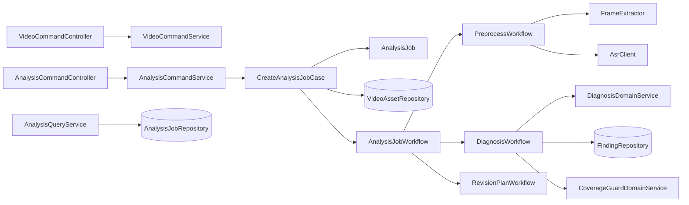
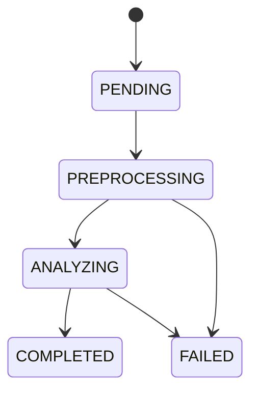
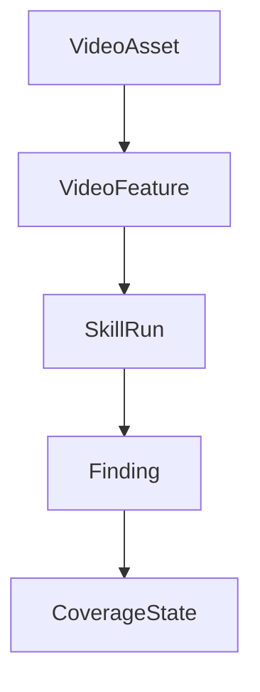

# 短视频对比诊断 Java 类清单与关系图

## 1. 目标

这份文档继续承接前面的 DDD 四层目录结构，重点回答三个问题：

- 每层具体放哪些类
- 类与类之间怎么协作
- 第一版工程应该先建哪些骨架

## 2. 第一版核心类清单

### 2.1 interface 层

#### controller
- `VideoCommandController`
- `AnalysisCommandController`
- `AnalysisQueryController`
- `HealthQueryController`

#### request
- `CreateVideoRequest`
- `CreateAnalysisJobRequest`

#### response
- `CreateAnalysisJobResponse`
- `AnalysisJobDetailResponse`
- `AnalysisJobResultResponse`

#### dto
- `VideoDTO`
- `AnalysisJobDTO`
- `FindingDTO`

#### vo
- `VideoVO`
- `AnalysisJobVO`
- `FindingVO`
- `CoverageStateVO`

#### assembler
- `VideoAssembler`
- `AnalysisJobAssembler`
- `FindingAssembler`

### 2.2 application 层

#### service
- `VideoCommandService`
- `AnalysisCommandService`
- `AnalysisQueryService`

#### command
- `CreateVideoCommand`
- `CreateAnalysisJobCommand`
- `RunAnalysisCommand`

#### query
- `GetAnalysisJobQuery`
- `GetAnalysisResultQuery`
- `GetVideoDetailQuery`

#### workflow
- `AnalysisJobWorkflow`
- `PreprocessWorkflow`
- `DiagnosisWorkflow`
- `RevisionPlanWorkflow`

#### case
- `CreateAnalysisJobCase`
- `ExecuteDiagnosisCase`
- `BuildResultCase`

### 2.3 domain 层

#### entity / model
- `VideoAsset`
- `AnalysisJob`
- `VideoFeature`
- `SkillDefinition`
- `SkillRun`
- `Finding`
- `CoverageState`

#### service
- `DiagnosisDomainService`
- `VideoFeatureDomainService`
- `FindingRankDomainService`
- `CoverageGuardDomainService`

#### repository
- `VideoAssetRepository`
- `AnalysisJobRepository`
- `VideoFeatureRepository`
- `SkillDefinitionRepository`
- `SkillRunRepository`
- `FindingRepository`
- `CoverageStateRepository`

#### policy
- `CoveragePolicy`
- `FindingRankPolicy`
- `EvidencePolicy`
- `HypothesisPolicy`

#### event
- `AnalysisJobCreatedEvent`
- `AnalysisJobCompletedEvent`
- `FindingGeneratedEvent`

#### valueobject
- `Evidence`
- `TimeRange`
- `VideoMeta`
- `SkillVersion`
- `Hypothesis`

### 2.4 infrastructure 层

#### repository
- `VideoAssetRepositoryImpl`
- `AnalysisJobRepositoryImpl`
- `VideoFeatureRepositoryImpl`
- `SkillDefinitionRepositoryImpl`
- `SkillRunRepositoryImpl`
- `FindingRepositoryImpl`
- `CoverageStateRepositoryImpl`

#### client
- `AsrClient`
- `ModelClient`
- `StorageClient`

#### adapter
- `AsrClientAdapter`
- `ModelClientAdapter`
- `StorageClientAdapter`

#### storage
- `MinioStorageClient`
- `S3StorageClient`

#### media
- `FfmpegMediaAdapter`
- `VideoMetadataReader`
- `FrameExtractor`
- `SceneSplitter`

#### mq
- `AnalysisJobMqProducer`
- `AnalysisJobMqConsumer`

#### cache
- `AnalysisJobCache`
- `VideoFeatureCache`

#### model
- `LlmDiagnosisAdapter`
- `VlmCoverAdapter`
- `PromptTemplateLoader`

### 2.5 types 层

- `Result`
- `ErrorCode`
- `JobStatusEnum`
- `VideoStatusEnum`
- `AnalysisDimensionEnum`
- `PriorityEnum`
- `CommonConstants`

## 3. 类与类之间的关系

### 3.1 领域主链路

### 3.2 任务状态流转

### 3.3 视频到诊断结果的关系

## 4. 聚合根建议

### 4.1 `AnalysisJob`

建议作为最核心聚合根。

理由：
- 一次诊断任务天然是一个完整事务边界
- 状态流转集中
- 结果汇总集中
- 与版本快照和证据链强相关

### 4.2 `VideoAsset`

建议作为输入素材聚合根。

理由：
- 视频资产的元数据、状态、文件地址需要统一管理
- 一个视频可能被多个任务引用

### 4.3 `SkillDefinition`

建议作为配置型聚合根。

理由：
- 版本化
- 开关控制
- 能力清单
- 规则约束

## 5. 值对象建议

### `Evidence`
- 记录时间戳、字幕片段、帧引用或数据引用

### `TimeRange`
- 表示 `start` 和 `end`

### `VideoMeta`
- 记录时长、格式、分辨率、码率等

### `SkillVersion`
- 表示某次任务运行时绑定的技能版本

### `Hypothesis`
- 表示一个诊断假设

## 6. 领域服务职责

### `DiagnosisDomainService`
- 整合多个维度的诊断结果
- 提炼出 1~3 个核心问题

### `FindingRankDomainService`
- 给多个 Finding 排优先级
- 过滤冗余建议

### `CoverageGuardDomainService`
- 检查必选维度是否被覆盖
- 标记 missing / checked / unchecked

### `VideoFeatureDomainService`
- 对预处理结果进行规范化
- 把多源 Feature 对齐成统一输入

## 7. 仓储职责

### domain 里只放接口

例如：
- `AnalysisJobRepository`
- `VideoAssetRepository`

### infrastructure 里放实现

例如：
- `AnalysisJobRepositoryImpl`
- `VideoAssetRepositoryImpl`

这样做的好处是：
- 领域层不依赖数据库
- 测试更容易
- 后续可以替换持久化实现

## 8. 第一版建议优先建的类

如果你准备真的开代码，建议先只建这些：

1. `AnalysisJob`
2. `VideoAsset`
3. `VideoFeature`
4. `Finding`
5. `CoverageState`
6. `AnalysisJobRepository`
7. `AnalysisCommandService`
8. `AnalysisJobWorkflow`
9. `FfmpegMediaAdapter`
10. `AsrClientAdapter`

这 10 个类或接口，基本就能把主链路骨架撑起来。

## 9. 第一版不要急着建的类

先别急着全建：

- 细分到每个分析维度的小 service
- 复杂事件总线
- 复杂的缓存拆分
- 复杂的策略工厂
- 太细的 DTO / VO

先保证主链路打通，再逐步抽象。

## 10. 一句话总结

这个项目的 Java 目录结构，关键不是“包名有多漂亮”，而是：

**让视频输入、任务编排、领域判断、技术实现各自待在自己的层里。**

